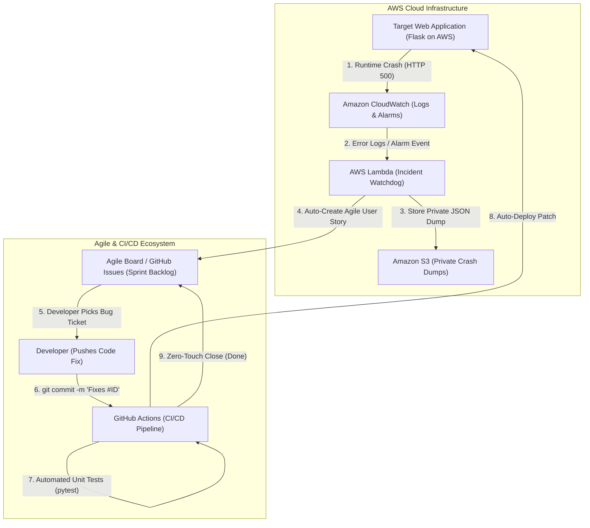

# Auto-Incident to Agile Ticket Pipeline (DevOps Incident Watchdog)

**Student Name:** S Hemal  
**Registration Number:** 24MIS0050  
**Institution:** Vellore Institute of Technology (VIT), Vellore Campus  
**Course:** Agile Development Process and DevOps  

---

## 📌 Executive Project Overview
In modern cloud engineering, a significant friction point exists between **Cloud Infrastructure Monitoring (DevOps)** and **Sprint Backlog Management (Agile)**. Monitoring alerts (CloudWatch, Datadog) frequently sit unnoticed in email inboxes or Slack channels. When an outage occurs, incident logs must be manually copy-pasted into sprint boards (Jira or GitHub Issues), leading to delayed Mean-Time-To-Acknowledge (MTTA), human error, and missing diagnostic context.

**DevOps Incident Watchdog** automates this entire feedback loop:
1. **Anomaly & Crash Detection**: Amazon CloudWatch proactively monitors the running web application. When a server crash or unhandled runtime failure occurs (HTTP 500), an anomaly is immediately flagged.
2. **Automated Incident Watchdog (AWS Lambda)**: A dedicated serverless function parses the crash logs, extracts stack traces and system metadata, uploads a private incident dump to **Amazon S3**, and automatically creates an actionable **Bug User Story** on the **Agile Kanban Board (GitHub Issues)**.
3. **Agile Triage & Zero-Touch Closing**: Developers pick up the bug story containing full crash context and S3 logs. Upon pushing a bug fix using smart commit syntax (e.g., `git commit -m "Fix calculation bug (Fixes #1)"`), the **GitHub Actions CI/CD pipeline** executes automated unit tests, deploys the updated code to AWS, and automatically transitions the Agile ticket to **Done**.

---

## 🏗️ System Architecture & Workflow



---

## 🚀 Key Features

- **Proactive Health Monitoring**: `/health` endpoint continuously reports system uptime and status code.
- **Autonomous Incident-to-Ticket Conversion**: Real-time REST API integration creates rich Agile User Stories directly in GitHub Issues with:
  - Incident ID & timestamp
  - S3 secure log dump URI
  - Full exception stack trace
  - Formatted **Agile Definition of Done / Acceptance Criteria**
- **Secure Log Storage**: Crash reports are archived in private Amazon S3 buckets with restricted IAM access policies and blocked public ACLs.
- **Continuous Integration (CI)**: GitHub Actions executes `pytest` automatically on every commit.
- **Continuous Delivery (CD)**: Verified code packages are deployed directly to AWS Lambda with zero downtime.
- **Zero-Touch Closing & Traceability**: Smart commit linking automatically updates sprint tickets, posts deployment audit verification comments, and marks tickets as **Done**.

---

## 📂 Project Structure

```text
devops-incident-watchdog/
├── .github/
│   └── workflows/
│       └── ci-cd.yml              # GitHub Actions CI/CD Pipeline
├── app/
│   ├── __init__.py
│   ├── app.py                     # Production Flask Web App (Health checks + business endpoints)
│   └── lambda_app_adapter.py      # Serverless WSGI Adapter for AWS Lambda & Function URLs
├── lambda_watchdog/
│   ├── __init__.py
│   └── watchdog.py                # Incident Watchdog Lambda (S3 dump + GitHub REST API caller)
├── tests/
│   ├── __init__.py
│   ├── test_app.py                # Unit tests for application endpoints
│   └── test_watchdog.py           # Unit tests for incident parsing & user story formatting
├── scripts/
│   ├── deploy_aws.py              # Automated 1-click AWS infrastructure provisioning script
│   ├── simulate_incident.py       # Live demo script to simulate an incident & trigger watchdog
│   └── test_pipeline_local.py     # Local end-to-end verification runner
├── requirements.txt               # Dependencies (Flask, boto3, requests, pytest)
├── README.md                      # Comprehensive project documentation
└── DEMO_GUIDE.md                  # Step-by-step Faculty Presentation & Viva Guide
```

---

## ⚙️ Quick Start & Local Verification

### 1. Install Dependencies
```bash
pip install -r requirements.txt
```

### 2. Run Local End-to-End Verification
```bash
python scripts/test_pipeline_local.py
```
This script tests:
1. Application health check baseline (`/health`)
2. Simulated runtime exception handling (`/simulate-crash`)
3. Watchdog log parsing & incident ID generation
4. Agile User Story markdown formatting
5. Automated unit testing (`pytest` passing all 8 tests)

---

## ☁️ Deploying to AWS

### Prerequisites
1. An AWS Account (Free Tier eligible).
2. Configure your AWS credentials using either:
   ```bash
   aws configure
   ```
   Or set environment variables in your terminal:
   ```powershell
   $env:AWS_ACCESS_KEY_ID="your_access_key"
   $env:AWS_SECRET_ACCESS_KEY="your_secret_key"
   $env:AWS_REGION="us-east-1"
   ```

### 1-Click AWS Provisioning Script
Run the automated deployment script:
```bash
python scripts/deploy_aws.py
```
This script automatically:
- Creates a private Amazon S3 bucket (`devops-incident-watchdog-logs-<account_id>-<region>`) with Public Access Block enabled.
- Configures the IAM Role (`DevOpsIncidentWatchdogLambdaRole`) with least-privilege policies.
- Deploys the target application on AWS Lambda with a live HTTPS Function URL.
- Deploys the Incident Watchdog Lambda (`watchdog-incident-creator`).

---

## 🔗 GitHub Board & CI/CD Integration

### 1. Set Up GitHub Secrets
In your GitHub Repository, navigate to **Settings** > **Secrets and variables** > **Actions** and add:
- `AWS_ACCESS_KEY_ID`: Your AWS access key
- `AWS_SECRET_ACCESS_KEY`: Your AWS secret key
- `AWS_REGION`: e.g. `us-east-1`
- `GITHUB_TOKEN`: GitHub automatically injects this into Actions workflows with issue write permissions.

### 2. Live Faculty Demo Script
To demonstrate the end-to-end flow to your faculty:
```bash
python scripts/simulate_incident.py
```
1. Watch the incident get detected.
2. Open your GitHub Issues / Projects board: the new Bug User Story will appear automatically!
3. Push a commit with `Fixes #1`:
   ```bash
   git commit -am "Fixes #1: Resolved calculation exception"
   git push origin main
   ```
4. Observe GitHub Actions CI/CD automatically run tests, deploy the fix, comment on the issue, and mark it **Closed / Done**!
